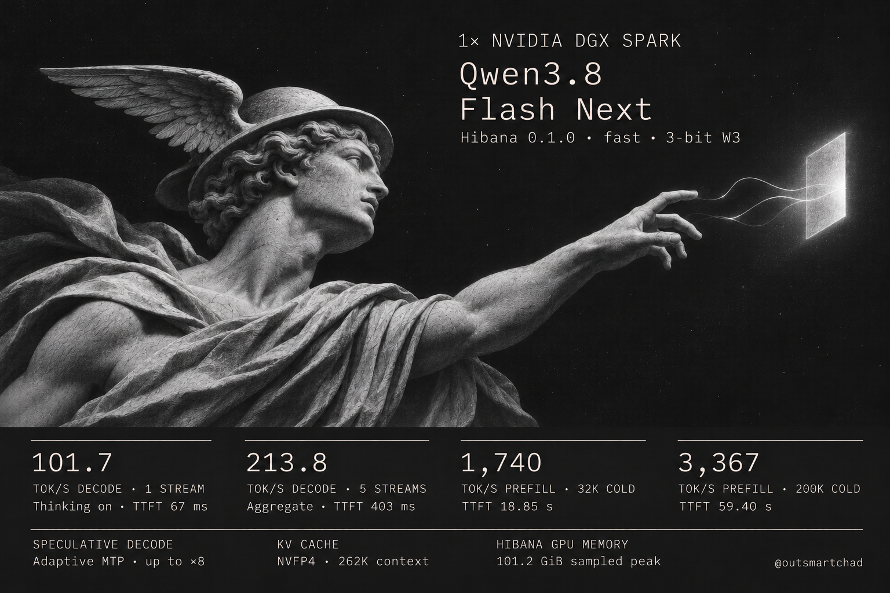

# Qwen3.8 Flash Next on one DGX Spark with Hibana

Single-stream prose decode with thinking on reached **101.7 tok/s** with Hibana `fast` and **56.0 tok/s** in the published TensorFold run. Hibana `fast` reached **220.9 tok/s aggregate at four streams** and **213.8 tok/s at five**. This recipe reproduces the serving configuration for both Hibana profiles and includes the matched TensorFold control, Traditional Chinese prompts, and OpenAI tool-call checks.

[Quick start](#quick-start) · [Setup](docs/setup.md) · [How it works](docs/how-it-works.md) · [Troubleshooting](docs/troubleshooting.md) · [Exact and fast](#exact-and-fast) · [Results and raw data](docs/benchmarking.md)

## Quick start

Run the commands **on one DGX Spark**. You need Linux ARM64, a working Docker GPU setup, Git, Bash, Python 3, and curl. The base weights use about **126 GiB** and the optional W3 weights use about **47 GiB**. Allow room for the build and CUDA caches too. [Host checklist and storage details](docs/setup.md#before-you-start)

```bash
git clone https://github.com/outsmartchad/qwen38-flash-next-single-dgx-spark-hibana.git &&
cd qwen38-flash-next-single-dgx-spark-hibana &&
./bin/recipe.sh build &&
./bin/recipe.sh fetch fast
```

`fetch fast` stages both checkpoints. Use `fetch exact` when you only want the base weights. You can build and download while another model serves. Before starting Hibana, pause other GPU inference workloads you control.

```bash
./bin/recipe.sh serve exact
```

Keep that terminal open while the weights load and kernels compile. Once it announces `http://127.0.0.1:18904`, run the smoke check in a second Spark terminal from the same checkout.

```bash
./bin/recipe.sh smoke exact
```

The check verifies the active profile, lists the model, and waits for the model to reply `READY`. Use `http://127.0.0.1:18904/v1` and model ID `RadixArk/Qwen3.8-Flash-Next-NVFP4` in an OpenAI-compatible client. [Send your own prompt](docs/setup.md#send-a-chat-request)

Stop exact from the second terminal, or press Ctrl-C in the serving terminal.

```bash
./bin/recipe.sh stop
```

Then start fast.

```bash
./bin/recipe.sh serve fast
```

After fast is ready, run `./bin/recipe.sh smoke fast` in the second terminal. Use `./bin/recipe.sh logs` while a test container exists. When finished, stop Hibana and restart the inference service you paused.

Both profiles passed the November 22, 2026 clean-install chat check on one DGX Spark. [Verification details](docs/setup.md#clean-install-check)



## Performance on one DGX Spark

Measured on November 21, 2026. All requests ran directly against the loopback API on the Spark. The test used the SparkDash hash-map prose prompt, thinking on, temperature 0.7, top-p 1, top-k 20, and 400 output tokens per request. Each row uses the fastest aggregate of three waves. TTFT is the median in that same wave.

| Streams | TensorFold same-session control (tok/s) | TTFT | Hibana exact tok/s | TTFT | Hibana fast tok/s | TTFT |
|---:|---:|---:|---:|---:|---:|---:|
| 1 | 44.5 | 63 ms | 50.8 | 87 ms | 101.7 | 67 ms |
| 2 | 76.4 | 93 ms | 73.8 | 112 ms | 147.3 | 522 ms |
| 3 | 99.4 | 121 ms | 88.4 | 111 ms | 172.2 | 178 ms |
| 4 | 108.9 | 152 ms | 104.8 | 787 ms | 220.9 | 124 ms |
| 5 | 111.4 | 186 ms | 116.6 | 228 ms | 213.8 | 403 ms |

The TensorFold control from the Hibana benchmark session reached **44.5 tok/s at one stream** and **111.4 tok/s at five**. The earlier published TensorFold run reached **125.6 tok/s at five streams**. Hibana uses the pinned RadixArk checkpoint, and the TensorFold recipe uses NVIDIA's NVFP4 checkpoint. This is a comparison of complete serving configurations. [Published TensorFold benchmark](https://github.com/outsmartchad/qwen38-flash-next-single-dgx-spark-tensorfold#decode-prose-thinking-on)

[Method, per-request decode rates and raw results](docs/benchmarking.md)

## Cold prefill and peak memory

The standard prefill sizes are **32K and 128K**. Hibana `fast` ran three fresh requests at each size after warm-up, with thinking off, temperature zero and zero cached prompt tokens.

| Target | Actual prompt tokens | Median prefill tok/s to first token | Median TTFT | Audit code |
|---:|---:|---:|---:|---:|
| 32K | 32,750–32,784 | 3,796 | 8.64 s | 3/3 |
| 128K | 131,085–131,126 | 3,536 | 37.07 s | 3/3 |

The sampled Hibana GPU process peak of **101.2 GiB** comes from the earlier memory run, which covered startup, 1–5 stream decode, and 32K/200K prefill. The card uses decode values from the matched comparison above and prefill medians from the 32K/128K run.

[32K/128K samples](results/fast.prefill-32k-128k.json) · [Earlier 32K/200K run](results/fast.prefill.json) · [Memory samples](results/fast.memory.json)

## Exact and fast

| Setting | `exact` | `fast` |
|---|---|---|
| Routed experts | Checkpoint NVFP4 | Calibrated 3-bit W3 |
| Trunk | FP8 at load | FP8 with calibrated 3-bit decode copies |
| KV cache | FP8 | NVFP4 |
| Speculative decoding | MTP ×4 | Adaptive MTP, up to ×8 |
| Sampled draft acceptance | Exact, `accept_soft=0` | Relaxed, `accept_soft=0.5` |
| Greedy draft acceptance | Top-1 | Top-3 within 2.0 logits |

The run used upstream Hibana v0.1.0 at `d474b74`, with up to five active requests and a configured prompt-plus-output limit of 262,144 tokens. The decode test used short prompts. [Upstream serving profiles](https://github.com/sharar-project/hibana/blob/d474b74d5a892b2cd1cc8fc50cb17946e2a539bb/docs/operations.md#serving-profiles)

## Traditional Chinese and tool calls

The quality probes used temperature zero and thinking off. Tool calls used fictional inventory data and a mock tool response.

| Configuration | Chinese exact matches | Tool checks |
|---|---:|---:|
| TensorFold 1.2.7 | 5/5 | 4/4 |
| Hibana `exact` | 5/5 | 3/4 |
| Hibana `fast` | 3/5 | 3/4 |

- Both Hibana profiles passed the English and Chinese inventory calls and the mock tool-result follow-up. Both serialized an `anyOf` array field as the string `"[\"cold\", \"priority\"]"`. That failed the argument-type check.
- `fast` returned `14:25` for a clock calculation whose expected answer was `15:25`. Its other strict mismatch was `數據庫` in place of `資料庫`, a valid Traditional Chinese wording variant.

[TensorFold probe output](results/tensorfold.checks.json) · [Exact probe output](results/exact.checks.json) · [Fast probe output](results/fast.checks.json)

## Multi-file coding benchmark

Measured on November 21, 2026 on one DGX Spark. Each profile started from the same [recipe checkout](https://github.com/outsmartchad/qwen38-flash-next-single-dgx-spark-tensorfold/commit/88fded2f17ca32c727d1220952fb6594ea0b8590). The task was to add a `--thinking` flag to the benchmark CLI, track first-token and first-answer times separately, and update the tests and docs. The untouched checkout passed 13 repository tests and failed all 10 checks for the new feature.

All three ran sequentially on loopback with thinking on, temperature zero and the same Python tool harness. Each had **32,768 total generated tokens** and up to **30 model turns**. A response could use the full remaining budget. Coding time includes model responses, tools and in-loop tests. Coding time excludes model startup and post-run grading.

| Serving profile | Coding time | Tokens used | Repo suite | Independent feature checks | End state |
|---|---:|---:|---:|---:|---|
| TensorFold 1.2.7 | 6m 19s | 22,331 | 13/13 | 9/10 | 30-turn limit |
| Hibana `exact` | 10m 12s | 32,768 | 13/13 | 10/10 | Token budget exhausted |
| Hibana `fast` | 4m 31s | 32,768 | 13/13 | 7/10 | Token budget exhausted |

- **TensorFold** updated the CLI, tests and docs. It reached the 30-turn limit with 10,437 tokens available. The remaining feature failure was the timestamp when answer text precedes reasoning.
- **Hibana `exact`** passed all 10 independent checks and its edited repository suite. It exhausted the budget with the documentation update still pending.
- **Hibana `fast`** ended sooner and passed seven independent checks. Its patch still lacked the CLI switch and failed the answer-before-reasoning timing case.

The untouched 13-test suite was also replayed against each patch. TensorFold passed 12, Hibana `exact` passed 11, and Hibana `fast` passed 13. The failures were mock callbacks that rejected the new `thinking` keyword.

The preceding 16,384-token run used the same harness without a per-response cap. All three exhausted that budget. The 32,768-token rerun is one attempt per serving profile on this task.

## Upstream and license

- [Hibana v0.1.0](https://github.com/sharar-project/hibana/releases/tag/v0.1.0)
- [RadixArk base checkpoint](https://huggingface.co/RadixArk/Qwen3.8-Flash-Next-NVFP4/tree/7b719225242aacd3dbd3f9407468c2ee9a9d2594)
- [Calibrated W3 checkpoint](https://huggingface.co/yemara/Qwen3.8-Flash-Next-NVFP4-sharar-w3-qad/tree/5c4c62a62853caebea8cedda7fbed952efa1effe)

The recipe scripts and documentation use the [MIT License](LICENSE). Upstream code and checkpoints are downloaded from their publishers under their respective licenses.
